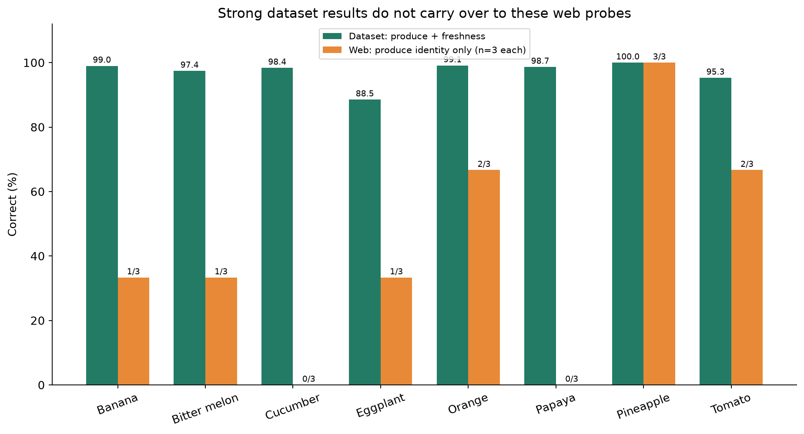
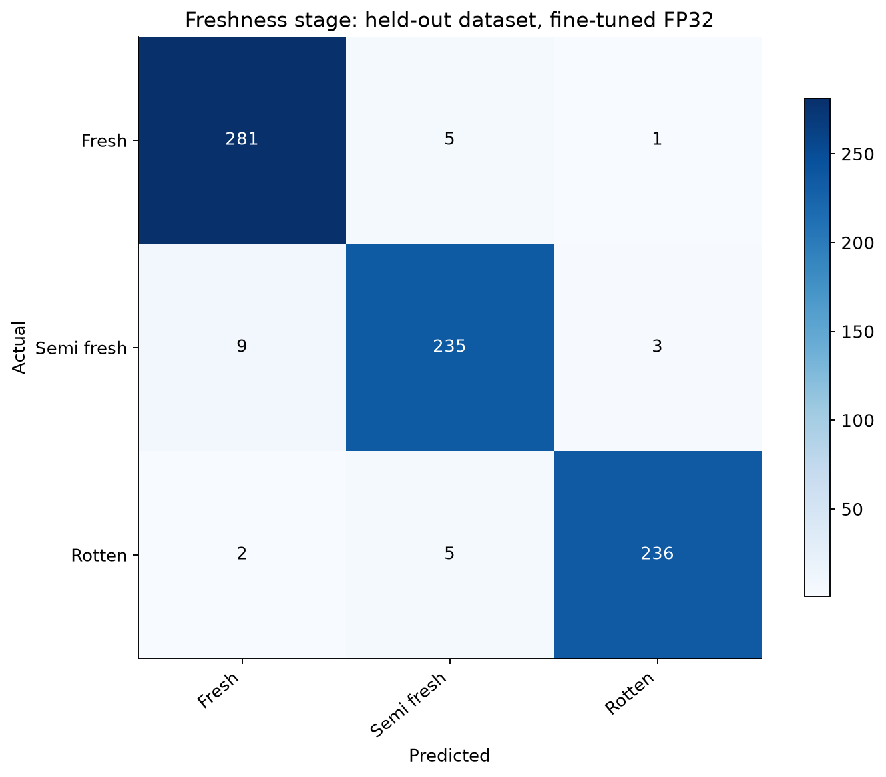
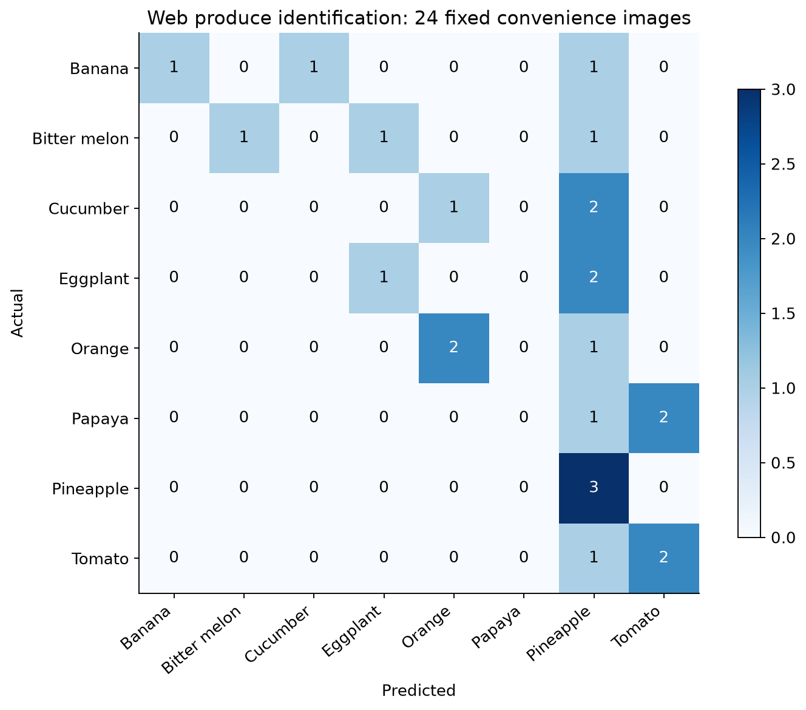
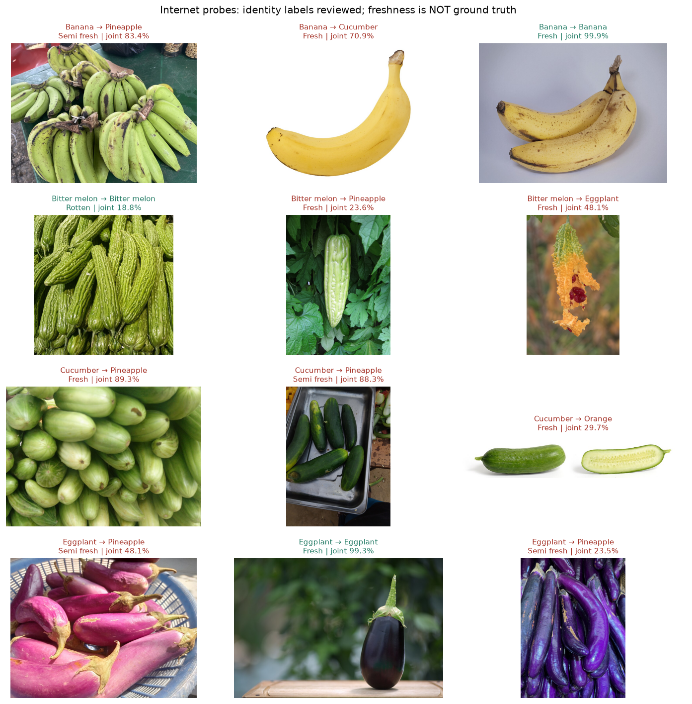
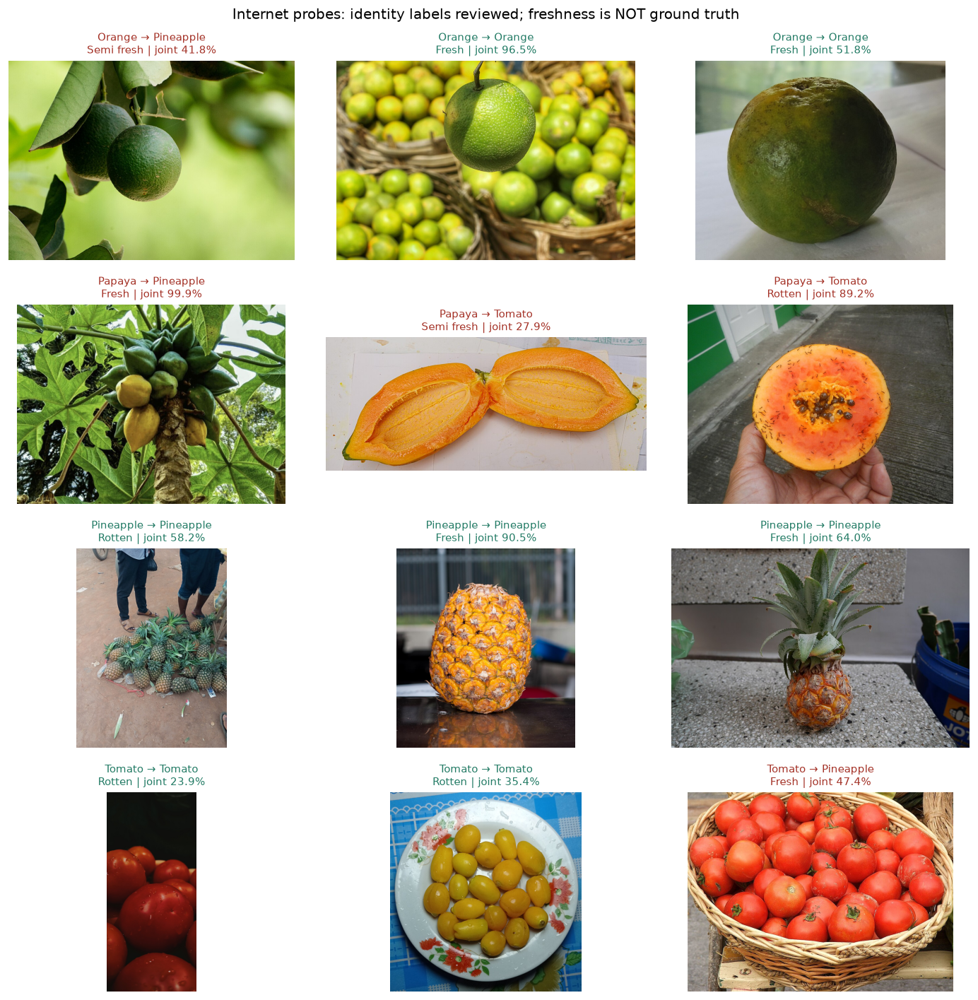
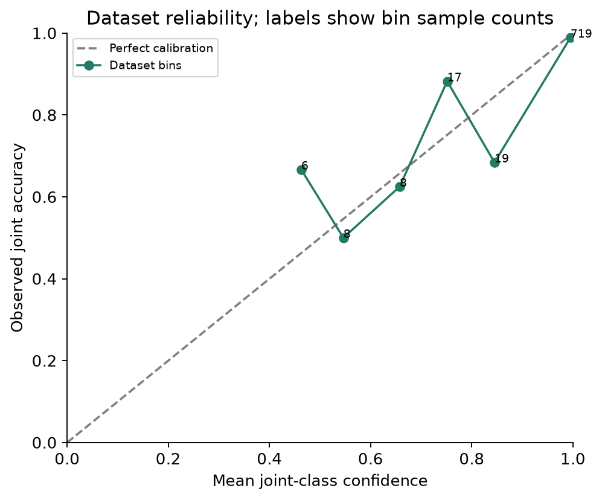
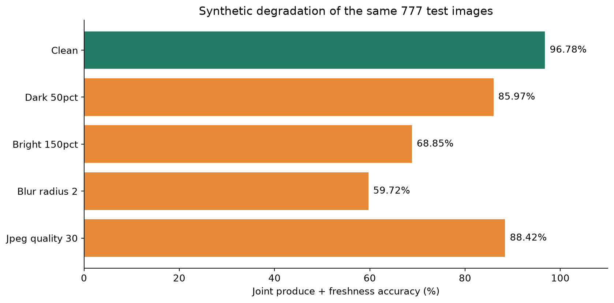

# FreshPick model evaluation — 26 October 2026

The fine-tuned model performs well on the prepared AgriFreshNET test split, but these experiments do not support calling it reliable on general internet or camera images. It correctly predicted both produce and freshness on 752/777 dataset images (96.78%); it identified the correct produce in only 10/24 selected internet images (41.67%). Both original and fine-tuned checkpoints achieved the same web identity count. Do not describe the web result as measured freshness accuracy: no verified freshness labels exist for those images.

This audit uses FP32 offline batches of 64 with the deployed preprocessing on the RX 7800 XT. The earlier training report evaluated with AMP and obtained 96.65% accuracy / 0.9626 macro F1. FP32 obtains 96.78% / 0.9657; this is a numerical precision/batching difference with one additional correct prediction net, not another training improvement. The audit batch size differs from single-image serving; the full dataset numbers are batched offline measurements. All 24 web identity predictions were separately verified through the live single-image API. No weights, deployment rules, or thresholds were changed during this audit.

## 1. Scope and reproducibility

Compared the original and fine-tuned MobileNetV3-Small checkpoints on the same 777 test images (3,621 training / 776 validation). Evaluated 24 joint classes (eight produce types × three inherited freshness stages), collapsed produce identity, collapsed freshness, confidence calibration, four synthetic corruptions, and the running HTTP API. Same EXIF/RGB/aspect-preserving 224×224 black-padding/ImageNet normalization as the app. No retraining or test-driven model selection was performed.

Checkpoint: a9e3a06213d9c2442700a88bf3f970ebd3ded9941e7b3ecb19355e2e99a5cf24. Split digest: 97a36346183f44b03205bd884896f7fd072635727d67eaac3c45fed3e81e30d8. Fine-tuned model version: mobilenetv3-small-a9e3a06213d9c244.

Internet probes: three images per produce, 24 in total. Search candidates were visually reviewed and the selection manifest frozen before inference. Excluded dishes, illustrations, maps, the wrong species (e.g. tamarillo), and ambiguous mixed-produce scenes. Kept cultivar variation, multiple same-type produce, on-plant views, and four cut/open-fruit images as clearly disclosed challenges. Images and identity labels were checked against source metadata and visible content; there was one reviewer, no independent labeling panel, and no freshness ground truth. Internet-image overlap with ImageNet pretraining cannot be excluded. This is a convenience stress probe, not a representative unbiased benchmark.

## 2. Overall measured results

| Metric | Original | Fine-tuned |
| --- | --- | --- |
| 24-class accuracy | 95.88% | 96.78% |
| Macro precision | 96.68% | 97.25% |
| Macro recall / balanced accuracy | 95.04% | 96.18% |
| Macro F1 | 0.9572 | 0.9657 |
| Weighted F1 | 0.9584 | 0.9676 |
| Produce identity accuracy (dataset) | 99.87% | 100.00% |
| Freshness accuracy (dataset) | 96.01% | 96.78% |
| Joint NLL (lower better) | 0.1206 | 0.0980 |
| Joint Brier sum (lower better) | 0.0649 | 0.0511 |
| ECE (10 equal-width bins) | 1.91% | 1.49% |
| Web identity correct | 10/24 (41.67%) | 10/24 (41.67%) |

## 3. Per-produce dataset performance and internet probes

Joint accuracy requires BOTH the right produce and freshness. Macro precision/recall/F1 average the three freshness-class metrics for that produce with equal weight; predictions into that produce from elsewhere count as false positives. All 777 produce identities were correct for the fine-tuned dataset pass, so remaining dataset errors are freshness confusions. Do not substitute the 100% produce identity result for freshness accuracy.

| Produce | Dataset n | Joint correct | Joint accuracy | Macro precision | Macro recall | Macro F1 | Web identity |
| --- | --- | --- | --- | --- | --- | --- | --- |
| Banana | 100 | 99/100 | 99.00% | 98.89% | 99.26% | 99.06% | 1/3 |
| Bitter melon | 78 | 76/78 | 97.44% | 98.04% | 96.08% | 96.91% | 1/3 |
| Cucumber | 62 | 61/62 | 98.39% | 99.05% | 95.24% | 96.95% | 0/3 |
| Eggplant | 96 | 85/96 | 88.54% | 89.84% | 88.06% | 88.46% | 1/3 |
| Orange | 113 | 112/113 | 99.12% | 99.10% | 99.44% | 99.26% | 2/3 |
| Papaya | 75 | 74/75 | 98.67% | 98.25% | 95.24% | 96.53% | 0/3 |
| Pineapple | 83 | 83/83 | 100.00% | 100.00% | 100.00% | 100.00% | 3/3 |
| Tomato | 170 | 162/170 | 95.29% | 94.84% | 96.09% | 95.39% | 2/3 |



## 4. Uncertainty from small samples

Intervals below are 95% Wilson intervals assuming independent trials. Related views violate that assumption, so even these intervals may be too optimistic. Three web images per produce cannot establish production accuracy. A 3/3 result has a lower bound of about 43.85%; 0/3 does not prove the model always fails.

| Produce | Dataset accuracy | 95% Wilson interval | Web identity | Web 95% Wilson interval |
| --- | --- | --- | --- | --- |
| Banana | 99.00% | 94.55%–99.82% | 1/3 | 6.15%–79.23% |
| Bitter melon | 97.44% | 91.12%–99.29% | 1/3 | 6.15%–79.23% |
| Cucumber | 98.39% | 91.41%–99.71% | 0/3 | 0.00%–56.15% |
| Eggplant | 88.54% | 80.64%–93.48% | 1/3 | 6.15%–79.23% |
| Orange | 99.12% | 95.16%–99.84% | 2/3 | 20.77%–93.85% |
| Papaya | 98.67% | 92.83%–99.76% | 0/3 | 0.00%–56.15% |
| Pineapple | 100.00% | 95.58%–100.00% | 3/3 | 43.85%–100.00% |
| Tomato | 95.29% | 90.99%–97.60% | 2/3 | 20.77%–93.85% |

## 5. Which freshness stages are missed?

Freshness is derived from the winning joint class, as in the UI. There are 2 inherited Rotten test labels predicted Fresh and 5 predicted Semi-fresh (243 Rotten examples total). These errors matter even when overall accuracy looks high. Eggplant is weakest overall: 85/96 joint predictions correct. Semi-fresh eggplant recall is 31/38 = 81.58%. Semi-fresh papaya and rotten cucumber each have only seven test examples; their class recall is unstable. In the offline audit, one test image has a winning-joint freshness stage different from the summed-marginal argmax; reported results follow the actual UI contract, not a substituted decision rule.

| Stage | precision | recall | f1-score | support |
| --- | --- | --- | --- | --- |
| fresh | 96.23% | 97.91% | 97.06% | 287 |
| semi_fresh | 95.92% | 95.14% | 95.53% | 247 |
| rotten | 98.33% | 97.12% | 97.72% | 243 |



## 6. All 24 joint classes

| Class | Precision | Recall | F1 | n |
| --- | --- | --- | --- | --- |
| fresh_banana | 100.00% | 100.00% | 100.00% | 26 |
| fresh_bittermelon | 100.00% | 100.00% | 100.00% | 29 |
| fresh_cucumber | 100.00% | 100.00% | 100.00% | 21 |
| fresh_eggplant | 83.33% | 100.00% | 90.91% | 35 |
| fresh_orange | 97.30% | 100.00% | 98.63% | 36 |
| fresh_papaya | 94.74% | 100.00% | 97.30% | 18 |
| fresh_pineapple | 100.00% | 100.00% | 100.00% | 33 |
| fresh_tomato | 97.65% | 93.26% | 95.40% | 89 |
| rotten_banana | 100.00% | 97.78% | 98.88% | 45 |
| rotten_bittermelon | 94.12% | 100.00% | 96.97% | 32 |
| rotten_cucumber | 100.00% | 85.71% | 92.31% | 7 |
| rotten_eggplant | 95.00% | 82.61% | 88.37% | 23 |
| rotten_orange | 100.00% | 100.00% | 100.00% | 17 |
| rotten_papaya | 100.00% | 100.00% | 100.00% | 50 |
| rotten_pineapple | 100.00% | 100.00% | 100.00% | 32 |
| rotten_tomato | 97.30% | 97.30% | 97.30% | 37 |
| semi_fresh_banana | 96.67% | 100.00% | 98.31% | 29 |
| semi_fresh_bittermelon | 100.00% | 88.24% | 93.75% | 17 |
| semi_fresh_cucumber | 97.14% | 100.00% | 98.55% | 34 |
| semi_fresh_eggplant | 91.18% | 81.58% | 86.11% | 38 |
| semi_fresh_orange | 100.00% | 98.33% | 99.16% | 60 |
| semi_fresh_papaya | 100.00% | 85.71% | 92.31% | 7 |
| semi_fresh_pineapple | 100.00% | 100.00% | 100.00% | 18 |
| semi_fresh_tomato | 89.58% | 97.73% | 93.48% | 44 |

## 7. Internet experiment: identity only

Fine-tuned macro precision = 48.96%, macro recall = 41.67%, macro F1 = 0.3798. Pineapple was predicted for 12/24 images, but only three were actual pineapples: its web precision is 25%. Cucumber and papaya had 0/3 correct identities; pineapple had 3/3, which is too small to establish reliability. The internet freshness outputs are predictions to inspect, not correctness labels. Natural ripening, yellowing, dark spots, and open ripe fruit must not automatically be labeled Rotten.

| Produce | precision | recall | f1-score | support |
| --- | --- | --- | --- | --- |
| banana | 100.00% | 33.33% | 50.00% | 3 |
| bittermelon | 100.00% | 33.33% | 50.00% | 3 |
| cucumber | 0.00% | 0.00% | 0.00% | 3 |
| eggplant | 50.00% | 33.33% | 40.00% | 3 |
| orange | 66.67% | 66.67% | 66.67% | 3 |
| papaya | 0.00% | 0.00% | 0.00% | 3 |
| pineapple | 25.00% | 100.00% | 40.00% | 3 |
| tomato | 50.00% | 66.67% | 57.14% | 3 |



## 8. Inspect the internet predictions: first 12



## 9. Inspect the internet predictions: remaining 12



## 10. Confidence does not transfer to the web

An on-tree papaya was classified as fresh pineapple with 99.92% winning-class confidence and 99.93% summed freshness confidence. Two cucumber photos were classified as pineapple with 89.34% and 88.32% joint confidence. A visually identifiable yellow banana on white background was classified as cucumber. These failures are consistent with domain/background/cultivar sensitivity; they do not prove which feature the network used. No validated feature explanation or causal background attribution was performed.

Dataset joint ECE is 1.49%, NLL 0.0980, and multiclass Brier sum 0.0511. These values only characterize this test distribution. Brier here sums squared errors over all 24 classes. Calibration bins are small outside the high-confidence group, and ECE alone can conceal subgroup failures. No temperature scaling or validated abstention threshold was fitted in this audit. A 90% confidence rule would still accept the papaya failure.



## 11. Synthetic image robustness

The same 777 prepared 224×224 images were degraded without changing labels: brightness multiplied by 0.5 or 1.5 (PIL clipping applies), Gaussian blur radius 2 pixels, and JPEG quality 30 before normal preprocessing. These are fixed stress settings, not estimates of the frequency or severity of real camera conditions. They demonstrate sensitivity and are not additional independent test samples.

| variant | n | joint_accuracy | macro_f1 |
| --- | --- | --- | --- |
| clean | 777 | 96.78% | 0.9657 |
| dark_50pct | 777 | 85.97% | 0.8347 |
| bright_150pct | 777 | 68.85% | 0.5962 |
| blur_radius_2 | 777 | 59.72% | 0.5431 |
| jpeg_quality_30 | 777 | 88.42% | 0.8623 |



## 12. Train/test similarity audit

No exact source-pixel hash overlaps between train and test were found. A 64-bit grayscale dHash nearest-neighbor screen found 33/777 test images within Hamming distance ≤3 of a training image and 117/777 within ≤5. Visual inspection of the eight closest pairs showed very similar backgrounds, poses, and produce appearance, consistent with related captures or near-duplicate views. Item identity cannot be proven without capture IDs, and dHash matches are not a measured leakage rate.

This reinforces the existing split limitation: random image splitting is not the same as testing on new produce items, sessions, cameras, or locations. The local evidence montage is runs/evaluation-web/nearest-train-test.jpg; pair paths and distances are in test-train-nearest-dhash.csv. Do not call a subset filtered by dHash a verified independent test.

## 13. Fine-tuning comparison is modest, not a proven domain improvement

On FP32 dataset inference the fine-tuned checkpoint gains seven correct predictions net: 19 original errors become correct while 12 previously correct cases become errors. The exploratory exact McNemar p-value is 0.281, which does not provide strong evidence of an improvement at 5% under independent paired-trial assumptions; related images and prior test reuse further limit that analysis. Web identity count stays at 10/24. More epochs on the same data are not the main next step.

## 14. Unsupported/nonproduce diagnostic

Four visually reviewed nonproduce images (shoes, an oil can, a street, and a clothing shop) were also sent to the running service. All four returned status ok and a supported produce label, as expected from a classifier with no unknown class. This is a diagnostic demonstration, not a measured general out-of-distribution rejection rate. The current service has no rejection gate.

| id | predicted_produce | predicted_freshness | class_confidence | freshness_confidence | status |
| --- | --- | --- | --- | --- | --- |
| banana_more_01 | cucumber | rotten | 74.01% | 76.15% | ok |
| banana_more_02 | cucumber | rotten | 41.59% | 54.63% | ok |
| banana_more_03 | papaya | rotten | 78.00% | 83.58% | ok |
| banana_more_05 | pineapple | fresh | 58.64% | 74.57% | ok |

## 15. Serving measurements

All 24 internet-image API predictions matched the offline fine-tuned produce predictions, and the server model version matched the checkpoint hash. HTTP upload/decode/preprocessing/GPU inference/JSON timing after three warmups: median 11.8 ms, p95 18.8 ms, range 6.9–21.6 ms over 24 sequential localhost requests. This excludes wide-area network latency, camera startup, concurrent load, and cold model loading. Speed is adequate for the prototype; data generalization is the pressing issue.

## 16. What to do next, in priority order

1. Build an independent camera benchmark before further tuning. Collect all eight produce types across devices, backgrounds, lighting, cultivars, and storage stages; retain item_id, capture_session, camera, site, and date. Assign all views/timepoints of one item to the same split. Keep a future collection/site/device untouched as a final test. Target at least 50 independent items per produce×freshness cell (1,200 item-level observations), then size the final study using the desired interval width; 50 is a pilot target, not a precision guarantee.
2. Improve labels. Write visible-condition criteria per produce and have two reviewers label images independently with disagreement adjudication. Distinguish unripe/ripe/overripe appearance from decay; mark ambiguous/occluded/cut/mixed-item images rather than forcing them into a freshness stage. Add a separate measurement protocol if shelf life is ever a goal.
3. Expand the training distribution. Add real phone photos, different backgrounds and cultivars, off-center objects, clutter, shadows, blur and compression. Prioritize eggplant freshness errors, cucumber/papaya identity failures, yellow/green cultivar variation, and the pineapple overprediction seen here. Add expert-reviewed negative/unsupported images. Keep this audit's web probes out of training until a new untouched benchmark is reserved.
4. Compare an object-crop/segmentation pipeline and a two-head produce+freshness model against the current 24-class baseline on identical grouped splits. A crop could reduce background sensitivity but must be measured, not assumed to solve it. Try brightness/color/blur/JPEG augmentation using training data only; keep realistic severity and verify per-produce recall.
5. Fit uncertainty behavior using validation data. Calibrate scores, evaluate selective accuracy versus coverage and per-produce coverage, and measure rejection on a held-out unsupported-image set. Low softmax confidence is not a verified unknown-item detector. Prevent a definitive assessment on rejected images; show a retake message. Do not deploy an arbitrary threshold based on these 24 probes.
6. Report the right release gates. Track joint macro F1, per-class recall with confidence intervals, especially Rotten recall and Rotten→Fresh mistakes; separately report produce identity, freshness, calibration, domain/slice robustness, and latency. Set acceptable errors and coverage with the intended users before training. Publish results from the untouched grouped benchmark, not just this reused random split.
7. Keep the current app clearly experimental until those checks pass. Show visible-condition limits, no shelf-life/food-safety claims, and no invented feature explanations. Do not turn confident failures into confident advice. A higher-scoring backbone is a later experiment after the data and evaluation protocol are fixed.

## 17. Metric definitions

Accuracy: fraction of predictions that match the label; joint accuracy requires both produce and freshness. Precision: TP/(TP+FP), answering how often a predicted class is correct. Recall: TP/(TP+FN), answering how many true examples were found. F1: harmonic mean of precision and recall. Support: number of true examples. Macro averages give each class equal weight; weighted averages weight by support. Multiclass balanced accuracy equals macro recall. Confusion matrices use actual classes as rows and predictions as columns. ECE compares confidence with correctness within bins; NLL penalizes assigning low probability to the true class. None of these is a food-safety probability. Web identity metrics do not measure freshness accuracy.

## Source attribution and individual experiment records

- [banana_04: File:Healthy Banana on Display.jpg](https://commons.wikimedia.org/wiki/File:Healthy_Banana_on_Display.jpg) — Iwai-Dialax; CC BY 4.0.

- [banana_direct_19231740: File:Banana-Single.jpg](https://commons.wikimedia.org/wiki/File:Banana-Single.jpg) — Evan-Amos; CC BY-SA 3.0.

- [banana_direct_24025750: File:Two ripe Cavendish bananas.jpg](https://commons.wikimedia.org/wiki/File:Two_ripe_Cavendish_bananas.jpg) — Assumulator; CC BY-SA 3.0.

- [bittermelon_06: File:Fresh bitter melon.jpg](https://commons.wikimedia.org/wiki/File:Fresh_bitter_melon.jpg) — Fumikas Sagisavas; CC0.

- [bittermelon_more_04: File:First bitter melon of the season.jpg](https://commons.wikimedia.org/wiki/File:First_bitter_melon_of_the_season.jpg) — Yun Huang Yong from Harbord, Australia; CC BY 2.0.

- [bittermelon_more_06: File:Momordica charantia - Bitter melon, Adana 2017-11-19 03-1.jpg](https://commons.wikimedia.org/wiki/File:Momordica_charantia_-_Bitter_melon,_Adana_2017-11-19_03-1.jpg) — Zeynel Cebeci; CC BY-SA 4.0.

- [cucumber_more_02: File:An image of Cucumbers.jpg](https://commons.wikimedia.org/wiki/File:An_image_of_Cucumbers.jpg) — Thamizhpparithi Maari; CC BY-SA 4.0.

- [cucumber_more_06: File:Unsliced fresh cucumber.jpg](https://commons.wikimedia.org/wiki/File:Unsliced_fresh_cucumber.jpg) — MaiDenzel; CC BY-SA 4.0.

- [cucumber_direct_5765366: File:Cucumber and cross section.jpg](https://commons.wikimedia.org/wiki/File:Cucumber_and_cross_section.jpg) — 


	
		
		fir0002  flagstaffotos [at] gmail.com
		Canon 20D + Sigma 150mm f/2.8

		
                    
                         
                         
                         
                         
                         
                         
		
	

; GFDL 1.2.

- [eggplant_01: File:Eggplant 3.jpg](https://commons.wikimedia.org/wiki/File:Eggplant_3.jpg) — GTSPACE; CC BY-SA 4.0.

- [eggplant_04: File:Lufa Farms Eggplant.jpg](https://commons.wikimedia.org/wiki/File:Lufa_Farms_Eggplant.jpg) — Lufa Farms; CC BY-SA 2.0.

- [eggplant_06: File:Japanese eggplants.jpg](https://commons.wikimedia.org/wiki/File:Japanese_eggplants.jpg) — Oleg Yunakov; CC BY-SA 4.0.

- [orange_02: File:Orange fruit ̠11.jpg](https://commons.wikimedia.org/wiki/File:Orange_fruit_%CC%A011.jpg) — Kwameghana(Bright Kwame Ayisi); CC BY-SA 4.0.

- [orange_03: File:Orange Fruit.jpg](https://commons.wikimedia.org/wiki/File:Orange_Fruit.jpg) — BishopNana; CC BY 4.0.

- [orange_05: File:Orange fruit (Citrus × sinensis).jpg](https://commons.wikimedia.org/wiki/File:Orange_fruit_(Citrus_%C3%97_sinensis).jpg) — Kuttykrishnan Photos; CC0.

- [papaya_01: File:Bunch of Papayas.jpg](https://commons.wikimedia.org/wiki/File:Bunch_of_Papayas.jpg) — Jovan Chris Barboza; CC BY-SA 4.0.

- [papaya_04: File:Carica papaya Fruit (2).jpg](https://commons.wikimedia.org/wiki/File:Carica_papaya_Fruit_(2).jpg) — Dinkun Chen; CC BY-SA 4.0.

- [papaya_05: File:2999Ants of the Philippines eating carica papaya fruit 01.jpg](https://commons.wikimedia.org/wiki/File:2999Ants_of_the_Philippines_eating_carica_papaya_fruit_01.jpg) — Judgefloro; CC0.

- [pineapple_01: File:Pineapple fruit, April 2023.jpg](https://commons.wikimedia.org/wiki/File:Pineapple_fruit,_April_2023.jpg) — Grace789; CC BY-SA 4.0.

- [pineapple_02: File:Pineapple fruit 2.jpg](https://commons.wikimedia.org/wiki/File:Pineapple_fruit_2.jpg) — Wilfredor; CC0.

- [pineapple_06: File:Mini pineapple.jpg](https://commons.wikimedia.org/wiki/File:Mini_pineapple.jpg) — Zenyrgarden; CC BY-SA 4.0.

- [tomato_01: File:Raw Tomatoes.jpg](https://commons.wikimedia.org/wiki/File:Raw_Tomatoes.jpg) — Happie1Soul; CC BY-SA 4.0.

- [tomato_03: File:Yellow Cherry Pear Tomatoes.jpg](https://commons.wikimedia.org/wiki/File:Yellow_Cherry_Pear_Tomatoes.jpg) — SarKaLay စာကလေး; CC BY-SA 4.0.

- [tomato_04: File:TOMATOES (2973653557).jpg](https://commons.wikimedia.org/wiki/File:TOMATOES_(2973653557).jpg) — KNOW MALTA by Peter Grima; CC BY-SA 2.0.

- [banana_more_01: File:2023-07-15-Marni-Banana.jpg](https://commons.wikimedia.org/wiki/File:2023-07-15-Marni-Banana.jpg) — Mossmoon; CC BY-SA 4.0.

- [banana_more_02: File:OMY Banana Oil (51888502386).jpg](https://commons.wikimedia.org/wiki/File:OMY_Banana_Oil_(51888502386).jpg) — Joost J. Bakker  IJmuiden; CC BY 2.0.

- [banana_more_03: File:Rua de Banana 1, Cidade Velha, Cape Verde.jpg](https://commons.wikimedia.org/wiki/File:Rua_de_Banana_1,_Cidade_Velha,_Cape_Verde.jpg) — Xandu; Public domain.

- [banana_more_05: File:Banana Republic Clothing Store - Chevy Chase - Maryland.jpg](https://commons.wikimedia.org/wiki/File:Banana_Republic_Clothing_Store_-_Chevy_Chase_-_Maryland.jpg) — Tony Webster; CC BY 2.0.

## Reproduce and inspect

Install ROCm PyTorch and run `.venv/bin/python -m pip install -e ".[api,evaluation]"`. With the local API running, execute:

```bash
.venv/bin/python scripts/fetch_web_evaluation.py
.venv/bin/python scripts/evaluate_models.py
.venv/bin/python scripts/audit_split_similarity.py
.venv/bin/python scripts/evaluate_live_service.py
.venv/bin/python scripts/build_evaluation_report.py
```

The downloader uses the frozen source manifest and verifies SHA-256; `--discover` searches for new candidates instead. Detailed CSV/JSON files and charts are in reports/evaluation/. Downloaded images and probability caches stay local in runs/evaluation-web/. The app and checkpoint were not changed by this evaluation.
